# Fake orbitting light

## The expected effect

Great lighting can add so much value to your 3D assets, but it can also be a bit tricky to get a precise lighting on some specific assets. For example, rim lights or hair highlights can be faked through shaders for better artistic control. In this article, we'll see how we can simulate the effect of a light orbitting around the mesh.

<center>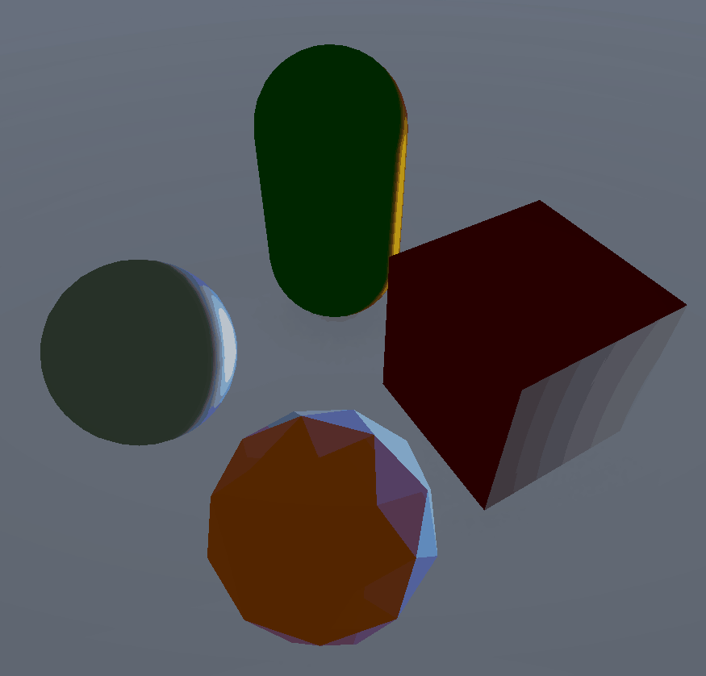</center>

## How it works

We'll treat the light as if it was a directional light. Since directional lights don't need positions, we only need to find it's direction. What's convenient about it is that it works for any mesh out of the box, whereas simulating a point light, for instance, would require a position. But since we do not have data on the whole mesh in the fragment shader, we wouldn't be able to prevent the point light intersecting with the mesh, and creating undesired effects (unless we put it far enough, but it would yield an inconsistent lighting).

So once we find the directional light's direction, we must apply it to the surface's color.

## The math behind

### Finding the light direction 
Rotations are all about trigonometry. To generate a rotating direction vector, we make use of Sine and Cosine, and make sure that they are out of sync so that the rotation appears random.
Using the time variable T, we can take for example :

```L = Vector3(Sin(T*3.5), Cos(T*4.5), Sin(T*5.5))```

Then normalize it to make sure we always have a unit vector.

Now we have our light direction, we can simply compute it's contribution to the surface using simple phong lighting.

<center>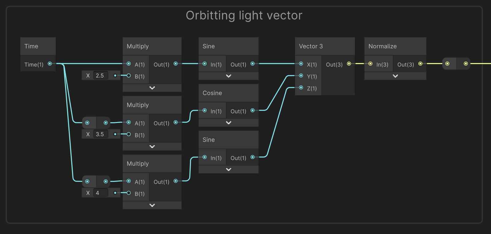
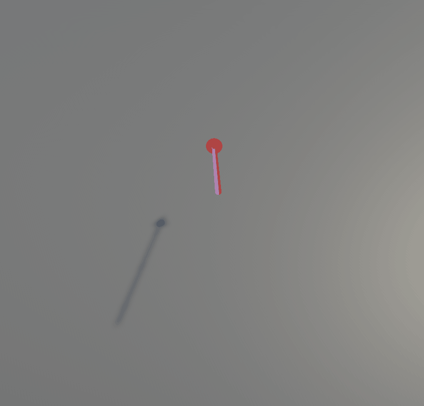</center>


### Phong lighting

<center>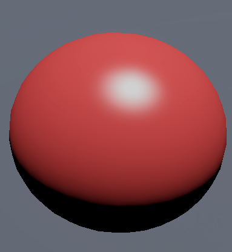</center>

**Diffuse lighting**

Given the surface normal N, we compute the incident diffuse light _Id_ by calculating the dot product of the negated light direction vector with the normal :

```Id = Dot(N, -L)```

We get Id in a [-1;1] range, since both N and L are of unit length.
It should then be clamped between 0 and 1 to avoid negative light contribution.

<center>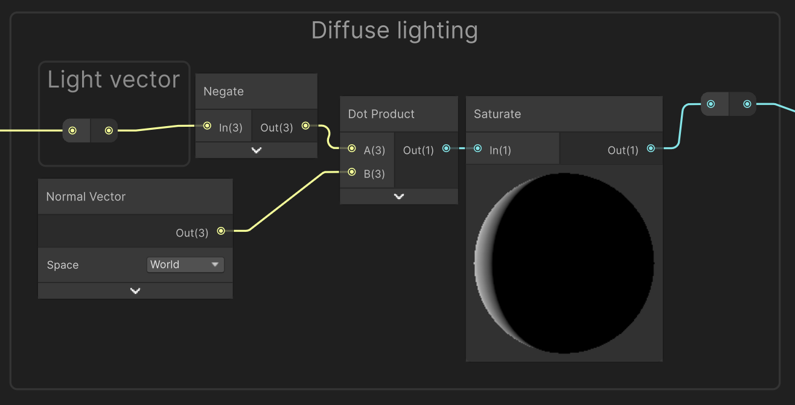</center>

We can then multiply _Id_ by the diffuse light color. Here we also multiply it by the alpha to allow control over the diffuse lighting's contribution.

<center>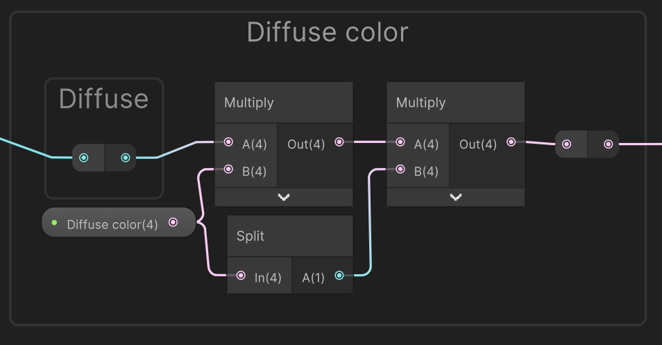</center>

<center>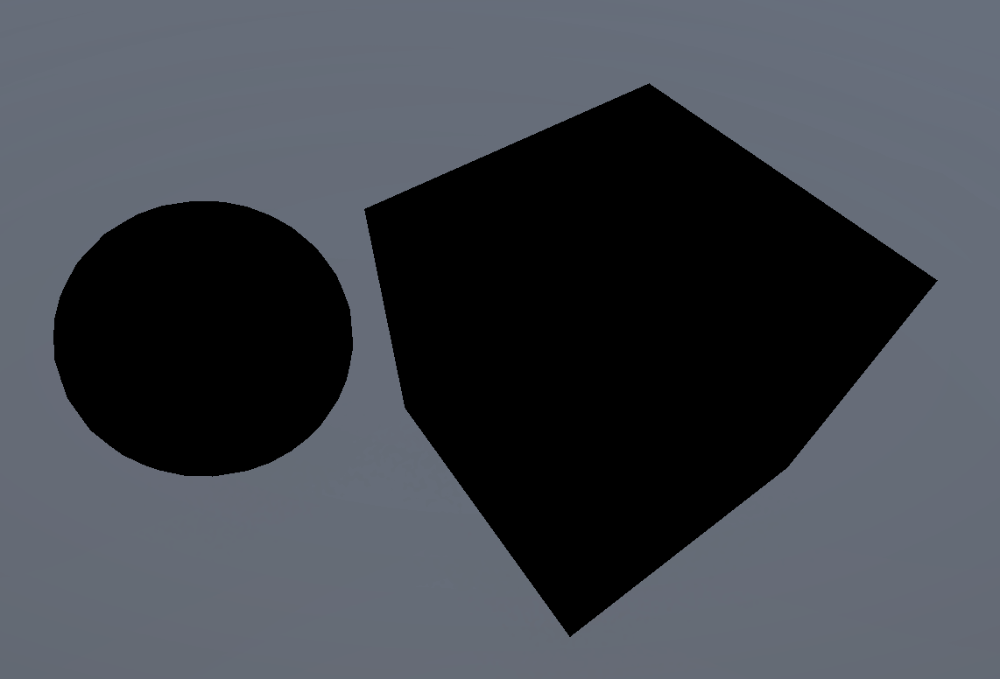</center>

**Specular lighting**

Now, if we want it, we can add specular lighting.

<center>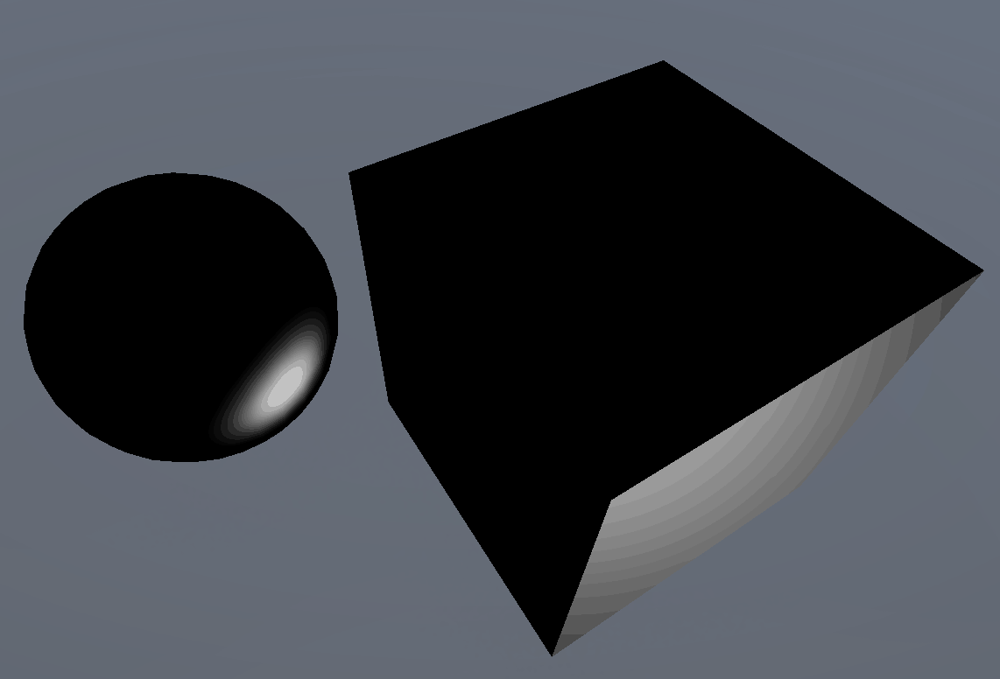</center>

First we find the reflected light vector :
```R = 2*Dot(-L, N)*N + L```

<center>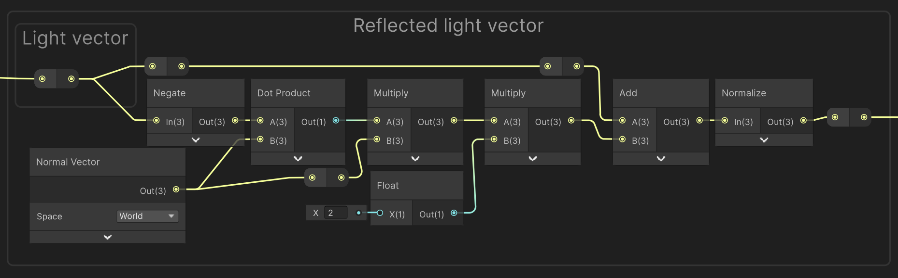</center>

<center>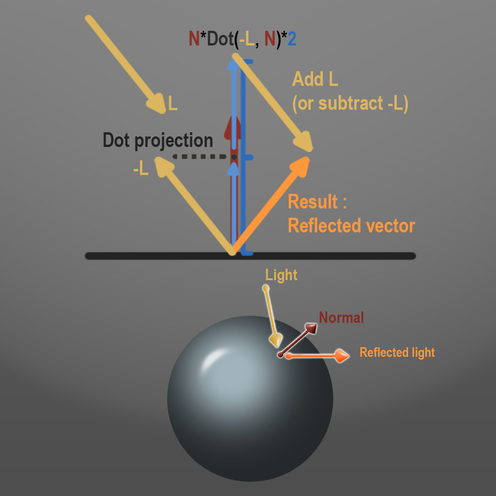</center>

Then the dot product between R and the camera view direction vector C.

```S = Dot(R, C)```

And finally, we exponentiate it by the specular intensity Ks.

```S = Dot(R, C)^Ks```

We should clamp this value to the [0;1] range to avoid undesired behaviour, multiply it by the specular color, and finally add it to the diffuse lighting.

<center>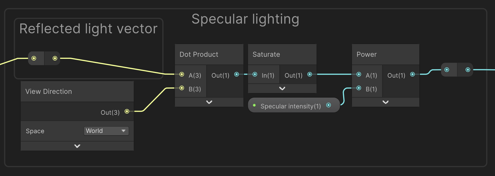</center>
<center>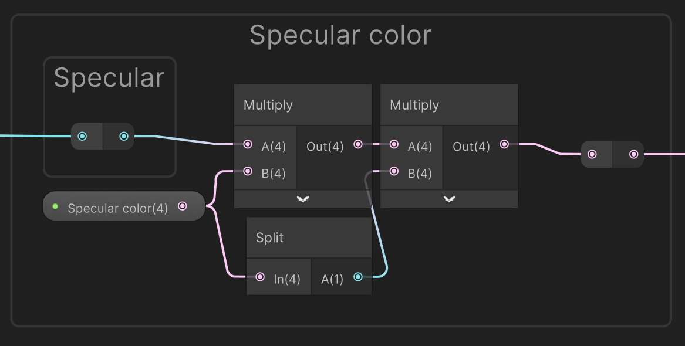</center>

<center></center>

## The final effect

Combining our orbitting light direction vector and phong lighting, we get a nice basis for a dynamic lighting effect. We can then extend it with further artistic choices to make it look better.

<center></center>
<center>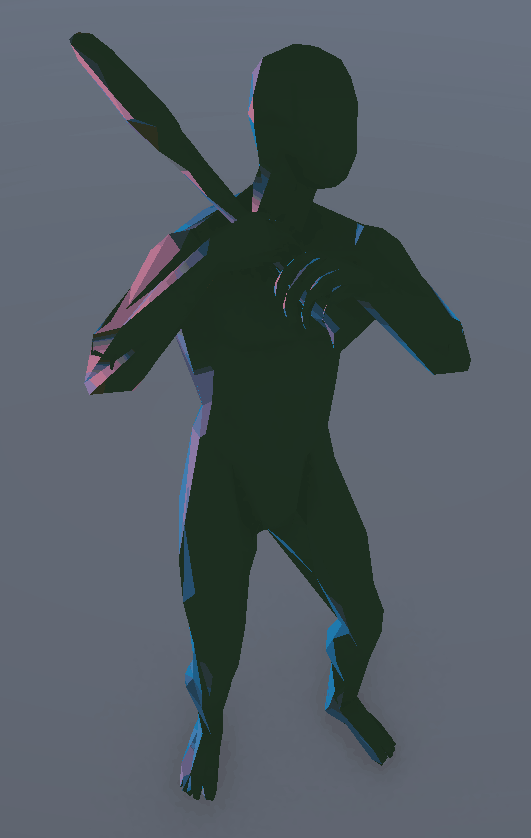</center>

