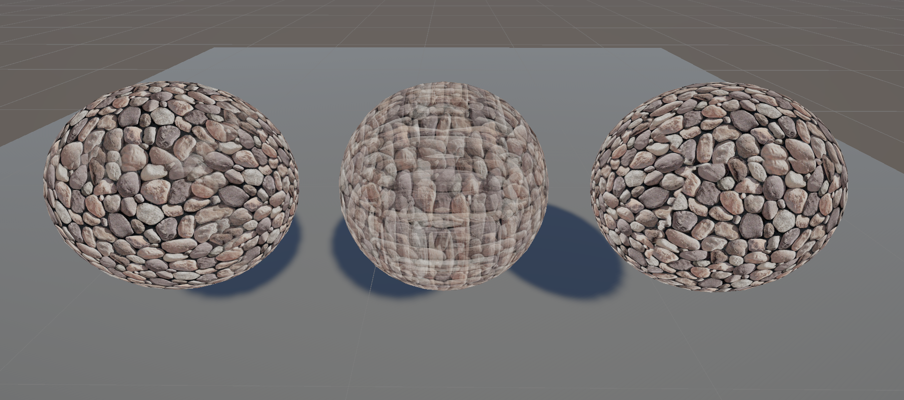
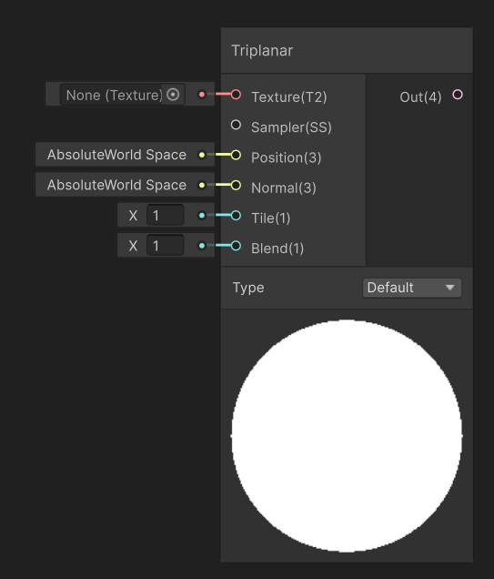
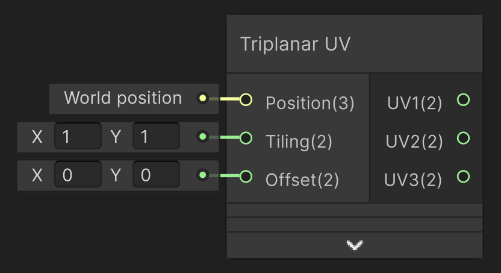
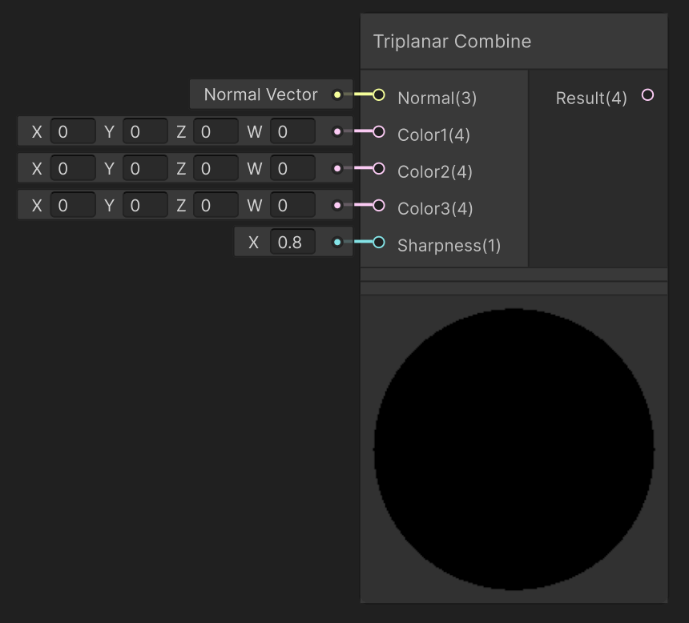

# Node-based triplanar blending

## What is triplanar blending ?

This page is not so much about presenting triplanar blending, since it's been explained by so many people already? But in short, it's a way to quickly project a texture onto 3D geometry without needing to unwrap it's UVs first. Instead, it uses the fragment's position and normal to determine where to sample the texture and from which angle.
For more details, [Ben Golus](https://bgolus.medium.com/) (a great technical artist and graphics programmer) wrote [this paper](https://bgolus.medium.com/normal-mapping-for-a-triplanar-shader-10bf39dca05a) on the subject.

## The problem I try to solve

The problem I try to solve can be encountered both in Unity and Unreal, and likely in other node-based shader systems as well. In this instance, I'll use Unity to present it, but the logic is applicable anywhere. Unreal already offers similar solutions, but with a bit less control.

Unity's ShaderGraph offers a simple node, "Triplanar", that takes a texture as input, automatically samples it from 3 different projection angles according to the given position and tiling values, and blends the samples according to the normal and blend factor.

The thing is, for procedurally generated patterns, there is no built-in solution for triplanar projection. When making effects directly with nodes inside ShaderGraph, you can't simply plug them in the texture input of the triplanar node, since there is no texture asset. You could try and bake the result to a texture in some way, but that would ruin all attempts at proceduralism.
The goal is then to find a way to sample our effect 3 times, from different angles, and to then blend these samples correctly.

## The solution

The solution is actually quite simple. We have to **generate 3 different UV coordinates**, which we will use to **apply our effect**, then take the results and **blend them**. Of course, we want this solution to be context-agnostic, and not depend on which effect we generate. In order to do that, we make use of two shader functions (or subgraphs) : The UV provider, and the triplanar blender.

## Generating the UVs

To generate the 3 UV coordinates, we simply take an input position XYZ, and output separately ZY, XZ and XY. The input position defaults to the world position to ensure ease of use and for the effect to be applied the same way on every object by default. We also provide tiling and offset controls by default in case we want to specify these uniformly accross the 3 texture coordinates. Of course we can still control them individually afterwards. The offset parameter isn't often needed, but it doesn't cost much to add it for some specific use cases.

## Blending the effects

Once we've used the given UV coordinates to generate our effect, we should get 3 corresponding color values. Just like with classic triplanar blending, we use the normal vector and blending factor (here named "Sharpness") to control the blending.

To blend everything, we use a standard method. We multiply each color by a factor, say O (for opacity), and sum them together.
To compute O, we take the normal and proceed like so :
- We normalize it just in case it is not of unit length
- We take it's absolute value to make sure that it's components are in the [0;1] range
- We exponentiate it by the blending factor (which here is remapped for ease of use, but it's optional as it may also confuse people who are used to using high blending values)
- We divide each component by the sum of all components, to make sure they add up to 1.
- We finally get O for each color input.

The output is the final blended value

## How to generate the effect

We now know how to make the two main shader functions, but a question still remains : How do we actually generate the pattern in-between ?
Well since we take UVs as the input and must output a color, it doesn't change that much from a regular workflow. The challenge lies in the fact that the graph must be duplicated 3 times, since loops don't exist in ShaderGraph (except in custom functions, but then their content has to be code as well).
To avoid flooding the graph, and to make sure we don't have to apply changes thrice upon modification, we can simply pack the effect in a subgraph, which will be duplicated, but that will nicely embed your effect in your graph while also improving legibility.

The following graph uses this method to generate a starry skybox, with a subgraph dedicated to the star effect. Position is used as normal since the normal isn't really provided with the skydome.

In this effect, if you look closely, you can still see a bit of the blending effect happening in some places. It could be gotten rid of with a higher blending factor, or simply by removing the blending and just using hard borders. But it serves as a nice example of how this can be used.

## Do you need the files ?

The two subgraphs as well as the starry skybox scene are available via a UnityPackage.
[Find it here](https://github.com/AntoninDF/AntoninDF.github.io/blob/main/src/resources/TriplanarBlendingNodes/TriplanarBlendingNodes_URP_6000.3.18f1.unitypackage)
It was tested on Unity URP 6000.3.18f1, but is simple enough so that it should be working on any version and render pipeline.
Don't hesitate to [contact me](../../ContactMe.md) if you have questions, remarks, need help or if you just want to chat about it !